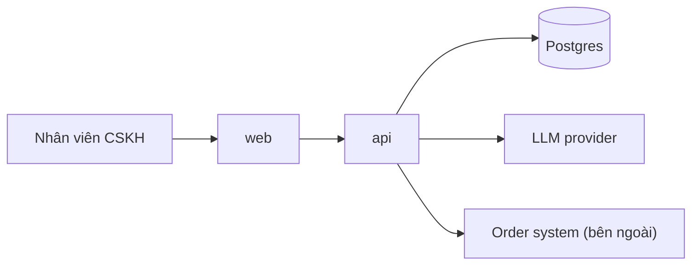

# Architecture: [tên dự án]

- **Status:** [Draft | Accepted | Superseded]
- **Owner:** [Tech Lead]
- **Updated:** [YYYY-MM-DD]
- **Related:** [SPEC](docs/SPEC.md) · [decisions](docs/decisions/README.md) · [domain](docs/domain.md)

> Điền ở Phase 2. Trang này giúp người mới và agent nắm hệ thống có những thành phần nào, dữ liệu đi đâu và giới hạn
> thiết kế là gì. Module và interface chi tiết nằm ở SPEC, lý do của từng quyết định lớn nằm ở ADR. Phần backend,
> frontend hoặc AI cần mô tả sâu thì viết ở [backend](docs/architecture/backend.md),
> [frontend](docs/architecture/frontend.md), [AI](docs/architecture/ai.md); phần không có thì bỏ file. Câu hỏi còn mở
> ghi ở [questions](docs/discovery/questions.md). Dòng in nghiêng và sơ đồ mẫu là ví dụ, xóa khi điền.

## Context

[Hệ thống phục vụ ai, nối với những hệ thống bên ngoài nào. Một đoạn.]

## Components

| Component | Responsibility | Depends on | Tech | Detail |
|---|---|---|---|---|
| *api* | *Nhận email, chạy pipeline AI, lưu bản nháp* | *Postgres, LLM provider, Order system* | *FastAPI (ADR-0002)* | *backend.md, ai.md* |
| *web* | *Hiển thị và sửa bản nháp* | *api* | *Next.js (ADR-0002)* | *frontend.md* |

## Main flows

[Mỗi luồng chính một đoạn hoặc một sơ đồ: các bước từ đầu vào tới kết quả, dữ liệu được lưu ở đâu, hệ thống làm gì
khi một phụ thuộc lỗi.]

## Data and trust boundaries

[Dữ liệu nhạy cảm đi qua thành phần nào, được gửi ra ngoài tới đâu, ai truy cập được. Chi tiết từng loại dữ liệu nằm ở
mục Sensitive data của [domain](docs/domain.md).]

## Deployment

| Environment | Purpose | Deploy | Config and secrets |
|---|---|---|---|
| *staging* | *Thử trước khi phát hành, chạy E2E* | *Tự động khi merge vào `main`* | *Biến môi trường; secret trong password manager* |
| *production* | *Người dùng thật* | *Ops chạy sau khi qua release gate* | *Như staging, key riêng* |

## Constraints

- [Ràng buộc ảnh hưởng tới thiết kế, kèm lý do và ADR nếu có. Ví dụ: dữ liệu khách không được rời khỏi Việt Nam.]
