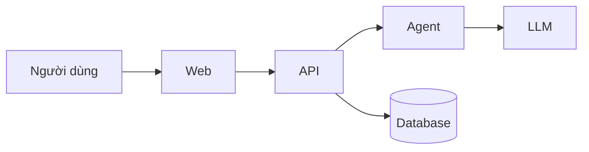

# Kiến trúc: <tên dự án>

> Trang này giúp người mới vào dự án và AI agent nắm được hệ thống gồm những gì, chạy thế nào, trong khoảng 5 phút. TL
> giữ file này. Chi tiết từng mảng nằm ở `docs/architecture/`, còn lý do chọn công nghệ nằm ở các ADR trong
> `docs/decisions/`.

## Sơ đồ tổng

<!-- Thay sơ đồ mẫu bằng hệ thống thật. Mỗi thành phần ở đây có một dòng trong bảng bên dưới. -->

## Thành phần

| Thành phần | Làm gì | Công nghệ | ADR | Chi tiết |
|---|---|---|---|---|
| Web | | | | [`frontend.md`](docs/architecture/frontend.md) |
| API | | | | [`backend.md`](docs/architecture/backend.md) |
| Agent | | | | [`ai.md`](docs/architecture/ai.md) |
| Database | | | | [`backend.md`](docs/architecture/backend.md) |

## Luồng chính

<!-- 2–4 luồng quan trọng nhất. Mỗi luồng vài bước đánh số, hoặc một sequence diagram. -->

## Deploy

<!-- Có những môi trường nào (local, staging, prod), mỗi môi trường chạy ở đâu, deploy bằng cách nào. -->

## Nguyên tắc

<!--
3–5 nguyên tắc kiến trúc mà ai cũng phải giữ. Ví dụ:
- LLM chọn, code tính: tiền, quyền, ngưỡng nằm trong code.
- `core` không import feature nào.
-->
