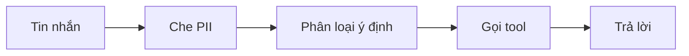

# Kiến trúc AI

> AI/ML giữ file này. Nó mô tả agent hoặc pipeline gồm những bước nào, gọi LLM ở đâu, giữ state ra sao và có những
> guardrail gì. Cách viết prompt và code AI xem ở `docs/conventions/ai.md`, cách đo xem ở `eval/plan.md`.

## Hướng đã chọn

<!-- Prompt, RAG, fine-tune hay train, kèm link tới ADR chọn hướng. -->

## Agent graph hoặc pipeline

<!-- Thay sơ đồ mẫu bằng graph thật. -->

## Node và tool

| Node hoặc tool | Làm gì | Có gọi LLM không | Model | Contract |
|---|---|---|---|---|
| | | | | |

## State và memory

<!-- Lưu gì trong một lượt, trong một hội thoại, lưu ở đâu và bao lâu. -->

## Latency và chi phí mỗi lượt

<!--
Ghi rõ một lượt gọi LLM mấy lần nối tiếp nhau, vì latency cộng dồn theo số lần đó.
Nếu tổng vượt ngân sách trong eval/plan.md thì ghi luôn cách giảm: chạy song song, model nhỏ hơn cho bước đơn giản, cache.
-->

| Bước | Gọi LLM | Nối tiếp bước trước | Latency dự kiến |
|---|---|---|---|
| | | | |

## Guardrail

<!--
- Che PII ở đâu, trước khi gửi LLM và ở mọi đường dữ liệu vào.
- Chống prompt injection thế nào.
- Việc nào bắt buộc người duyệt.
- Luật nào code tính, không để LLM tự quyết.
-->

## Thêm một feature

<!-- Feature mới thêm node, tool, prompt ở đâu mà không phải sửa file trung tâm. -->

## Phần train

<!-- Chỉ điền nếu dự án train hoặc fine-tune: data pipeline, training pipeline, model registry, cách serve. Không thì xoá mục này. -->
