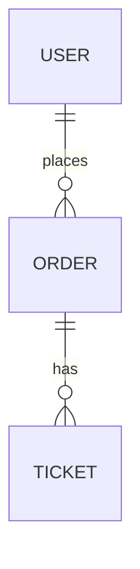

# Data model

> File này ghi các thực thể, quan hệ giữa chúng, các trạng thái, và trường nào chứa PII. Tên bảng và tên trường dùng đúng
> tên trong `glossary.md`.

## Sơ đồ

<!-- Thay sơ đồ mẫu bằng các thực thể thật. -->

## Thực thể

| Thực thể | Trường chính | Quan hệ | Ghi chú |
|---|---|---|---|
| | | | |

## Trạng thái

| Thực thể | Trạng thái | Chuyển sang được | Điều gì làm chuyển, ai làm |
|---|---|---|---|
| | | | |

## PII

| Trường | Loại PII | Lưu thế nào | Ai được xem bản đầy đủ |
|---|---|---|---|
| | | Mã hoá, hash, hay che | |
