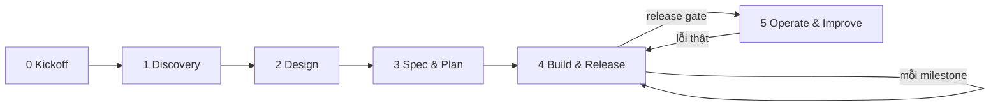

# Playbook

Playbook chia dự án thành sáu phase, dùng chung một bộ vai và một working agreement. Trang này tóm tắt nguyên tắc, các
phase và cách chọn tài liệu theo loại dự án.

Các file trong `docs/playbook/` là hướng dẫn và default, dùng chung cho mọi dự án. Nhóm làm khác default ở đâu thì ghi
vào [team.md](../team.md), không sửa ở đây. Các mẫu cần điền nằm ở phần còn lại của `docs/`.

## Principles

1. **Ghi lại rồi mới làm.** Quyết định và thay đổi nằm trong repo hoặc tracker và được duyệt qua PR. Thảo luận trong
   chat thì tóm tắt về đó.
2. **Mỗi thông tin một nguồn.** Nơi khác cần thì link tới, không chép lại.
3. **Đo trước, xây sau.** Chỉ số và dữ liệu eval có trước code của phần được đo.
4. **LLM chọn, code tính.** Tiền, quyền và ngưỡng nằm trong code hoặc config, không nằm trong prompt.
5. **Mỗi quy tắc có cách kiểm.** Máy kiểm được thì để CI kiểm; không thì đưa vào checklist review.
6. **Báo đúng bằng chứng.** Kết quả ghi rõ đã chạy gì, ở môi trường nào và phần nào chưa kiểm.
7. **Exit criteria chặn việc chốt, không chặn việc bắt đầu.** Việc của phase sau có thể làm nháp từ sớm.

## Phases

| Phase | Goal | Key output | Exit criteria |
|---|---|---|---|
| 0 Kickoff | Thống nhất cách phối hợp, dựng repo và công cụ | `team.md`, `main` được bảo vệ | `team.md` đã merge |
| 1 Discovery | Hiểu bài toán, spike trên mẫu thật, chọn hướng | Brief, questions, ADR-0001 | Brief ghi `Go`, `Pivot` hoặc `Stop` |
| 2 Design | Chốt kiến trúc, domain và shared contract | `ARCHITECTURE.md`, domain, ADR, staging | Contract đã merge, staging deploy được |
| 3 Spec & Plan | Chốt làm gì, thế nào là đạt, làm theo thứ tự nào | PRD, SPEC, eval plan, test set, task | SPEC v1.0 `Accepted`, test set đã freeze |
| 4 Build & Release | Làm theo vertical slice, phát hành theo milestone | Code, kết quả eval, bản phát hành | Qua release gate |
| 5 Operate & Improve | Theo dõi, xử lý sự cố, đưa lỗi thật về eval | Monitoring, runbook, ca eval mới | Chạy liên tục |

Chi tiết từng phase ở [phases.md](phases.md). Sau Exit criteria của Phase 3, thay đổi hành vi đã cam kết đi theo
[change-control.md](change-control.md).

## Project types

Chọn cột gần với dự án nhất. Cột Production là default của [phases.md](phases.md).

| Artifact | PoC | Internal tool | Production |
|---|---|---|---|
| Brief, questions | ✅ | ✅ | ✅ |
| ADR-0001 (AI approach) | Gộp vào brief | ✅ | ✅ |
| Domain | — | Khi có luật nghiệp vụ | ✅ |
| ARCHITECTURE.md | Một đoạn | ✅ | ✅, thêm backend, frontend, AI khi cần |
| PRD | — | ✅ | ✅ |
| SPEC | Một trang, gồm acceptance criteria | ✅ | ✅ |
| Eval | Smoke set 10–20 ca | Golden set và baseline | Thêm test set freeze và release gate |
| Staging | — | ✅ | ✅ |
| Phase 5 | — | Error log, chi phí LLM, rollback | Monitoring, trace, runbook, incident |

## Guides

| File | Nội dung |
|---|---|
| [phases.md](phases.md) | Goal, output, owner, exit criteria và activities của từng phase |
| [roles.md](roles.md) | Sáu vai, cách ghép người khi nhóm nhỏ, quy tắc tránh xung đột lợi ích |
| [working-agreement.md](working-agreement.md) | Default về task, nhánh, review, merge và Definition of Done |
| [change-control.md](change-control.md) | Loại thay đổi, ai duyệt, quy trình CR sau khi đã chốt |
| [documents.md](documents.md) | Tài liệu nào trả lời câu hỏi nào, quy ước của mẫu, cách viết |
| [eval.md](eval.md) | Default về eval: metric, scorer, dataset, lịch chạy, cách báo kết quả |
