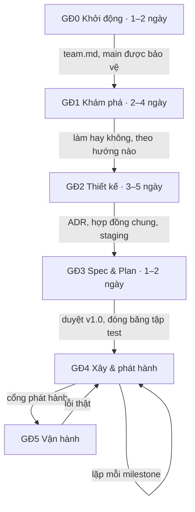

# Quy trình

> **Người đọc:** mọi thành viên và AI agent. File này là mục lục của quy trình: nguyên tắc, các giai đoạn, và file nào
> ghi gì. Chi tiết nằm ở các file được trỏ tới.

## Nguyên tắc

1. **Viết ra trước, làm sau.** Thông tin, quyết định, thay đổi nằm trong repo và được duyệt qua PR. Chỉ nằm trong
   chat thì coi như chưa có.
2. **Mỗi thông tin một chỗ.** File khác trỏ tới, không chép lại ([`documents.md`](documents.md)).
3. **Đo trước, xây sau.** Chỉ số và bộ dữ liệu đo có trước phần code mà nó đo ([`eval.md`](eval.md)).
4. **LLM chọn, code tính.** Tiền, quyền, ngưỡng nằm trong code và config, không nằm trong prompt.
5. **Luật phải được máy kiểm**, hoặc nằm trong checklist review. Luật chỉ có trên giấy sẽ dần lệch khỏi thực tế.
6. **Cổng chặn việc chốt, không chặn việc bắt đầu.** Việc của giai đoạn sau được làm nháp sớm.

## 6 giai đoạn

| GĐ | Mục tiêu | Đầu ra chính |
|---|---|---|
| 0 Khởi động | Thống nhất cách làm, có repo, CI, board | `team.md`, repo đã bảo vệ `main` |
| 1 Khám phá | Hiểu bài toán, thử nhanh, chọn hướng | `brief.md`, sổ câu hỏi, ADR chọn hướng |
| 2 Thiết kế | Chốt cấu trúc, luật nghiệp vụ, cách đo, hợp đồng chung | ADR, `ARCHITECTURE.md`, `domain/`, `ui-flow.md`, staging |
| 3 Spec & Plan | Chốt bản này xây gì, thế nào là đạt, thứ tự xây | `prd.md`, `SPEC.md` v1.0, `eval/plan.md`, tập test, `tasks/plan.md` |
| 4 Xây & phát hành | Xây theo lát dọc, mỗi milestone là một bản phát hành | Code, kết quả eval, bản phát hành |
| 5 Vận hành | Giữ sản phẩm chạy ổn, biến lỗi thật thành cải tiến | Giám sát, runbook, dòng eval mới |

Từ cổng GĐ3, mọi thay đổi theo [`change-control.md`](change-control.md).

## File trong thư mục này

| File | Nội dung |
|---|---|
| [`phases.md`](phases.md) | Việc, người chủ trì, thứ tự và cổng của từng giai đoạn |
| [`roles.md`](roles.md) | Vai trò, cách ghép người, luật tránh xung đột |
| [`working-agreement.md`](working-agreement.md) | Luật làm việc mặc định: nhận task, review, merge, Definition of Done |
| [`change-control.md`](change-control.md) | Kiểm soát thay đổi theo 3 bậc |
| [`documents.md`](documents.md) | Thông tin nào nằm ở file nào |
| [`eval.md`](eval.md) | Luật eval: lõi chung và hai biến thể |
| [`team.md`](team.md) | Điền ở kickoff: ai giữ vai nào, công cụ, luật nhóm sửa so với mặc định |
