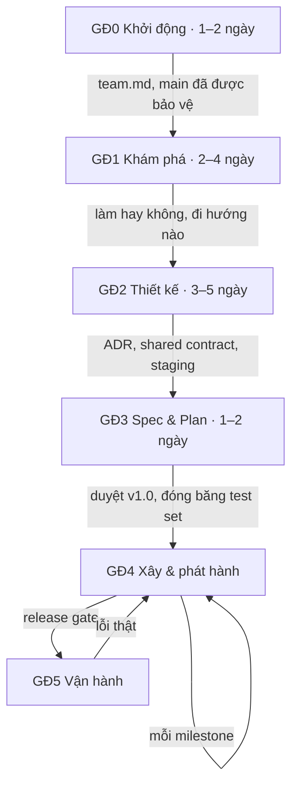

# Quy trình

> Trang này dành cho mọi thành viên và AI agent. Nó tóm tắt nguyên tắc chung, 6 giai đoạn của dự án, và chỉ ra chi tiết
> nằm ở file nào.

## Nguyên tắc

1. **Viết ra trước rồi mới làm.** Thông tin, quyết định và thay đổi đều nằm trong repo, được duyệt qua PR. Thứ chỉ nằm
   trong chat coi như chưa có.
2. **Mỗi thông tin chỉ ghi ở một chỗ.** File khác cần thì link tới, không chép lại ([`documents.md`](documents.md)).
3. **Đo trước, xây sau.** Chỉ số và dữ liệu để đo phải có trước khi viết code cho phần đó ([`eval.md`](eval.md)).
4. **LLM chọn, code tính.** Tiền, quyền và ngưỡng nằm trong code và config, không nằm trong prompt.
5. **Luật nào cũng phải có cách kiểm.** Máy kiểm được thì để CI kiểm, không thì đưa vào checklist review. Luật chỉ nằm
   trên giấy thì sớm muộn cũng bị bỏ qua.
6. **Gate chỉ chặn việc chốt, không chặn việc bắt đầu.** Việc của giai đoạn sau có thể làm nháp từ sớm.

## 6 giai đoạn

| GĐ | Mục tiêu | Đầu ra chính |
|---|---|---|
| 0 Khởi động | Thống nhất cách làm việc, dựng repo, CI và board | `team.md`, repo đã bảo vệ `main` |
| 1 Khám phá | Hiểu bài toán, thử nhanh trên dữ liệu thật rồi chọn hướng | `brief.md`, sổ câu hỏi, ADR chọn hướng |
| 2 Thiết kế | Chốt kiến trúc, luật nghiệp vụ, cách đo và shared contract | ADR, `ARCHITECTURE.md`, `domain/`, `ui-flow.md`, staging |
| 3 Spec & Plan | Chốt bản này làm gì, thế nào là đạt và làm theo thứ tự nào | `prd.md`, `SPEC.md` v1.0, `eval/plan.md`, test set, `tasks/plan.md` |
| 4 Xây & phát hành | Làm theo từng vertical slice, mỗi milestone ra một bản phát hành | Code, kết quả eval, bản phát hành |
| 5 Vận hành | Giữ sản phẩm chạy ổn và biến lỗi thật thành cải tiến | Monitoring, runbook, dòng eval mới |

Sau gate của GĐ3, mọi thay đổi đi theo [`change-control.md`](change-control.md).

## Các file trong thư mục này

| File | Nội dung |
|---|---|
| [`phases.md`](phases.md) | Việc cần làm ở từng giai đoạn, ai chủ trì, việc nào chờ việc nào, gate để đi tiếp |
| [`roles.md`](roles.md) | Các vai, cách ghép người, luật tránh xung đột lợi ích |
| [`working-agreement.md`](working-agreement.md) | Luật làm việc mặc định: nhận task, review, merge, Definition of Done |
| [`change-control.md`](change-control.md) | Ba mức thay đổi và cách làm một CR |
| [`documents.md`](documents.md) | Thông tin nào nằm ở file nào, cách viết tài liệu |
| [`eval.md`](eval.md) | Luật eval chung và hai biến thể |
| [`team.md`](team.md) | Mẫu để nhóm điền ở kickoff: ai giữ vai nào, dùng công cụ gì, đổi luật nào |
