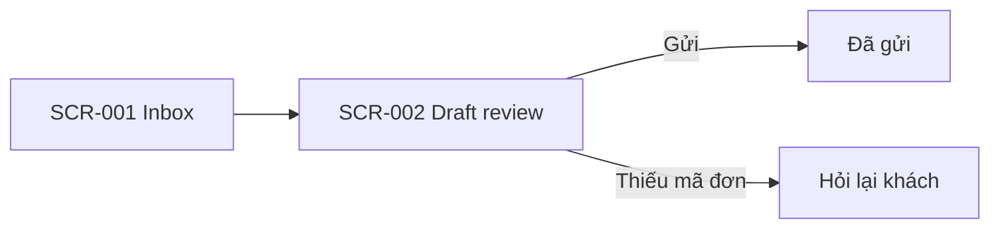

# UI flow: [tên dự án]

- **Status:** [Draft | Accepted | Superseded]
- **Owner:** [UX]
- **Updated:** [YYYY-MM-DD]
- **Related:** [PRD](prd.md) · [domain](domain.md) · [frontend](architecture/frontend.md)

> Điền ở Phase 2 khi sản phẩm có giao diện; nếu không thì bỏ file. Mỗi màn hình có mã `SCR-xxx` và dẫn tới user story
> `US-xxx`, luật `BR-xxx` thay vì viết lại. Trang này mô tả người dùng thấy gì; quyền thật sự được kiểm ở backend. Dòng
> in nghiêng và sơ đồ mẫu là ví dụ, xóa khi điền.

## Users

| User | Goal | Can see and do |
|---|---|---|
| *Nhân viên CSKH* | *Trả lời email khiếu nại trong ngày* | *Xem, sửa và gửi bản nháp của nhóm mình* |

## Flows

[Mỗi luồng chính: bắt đầu ở đâu, các bước, nhánh hủy hoặc lỗi, kết thúc ở đâu.]

## Screens

Mỗi màn hình một mục như dưới.

### SCR-001: [tên màn hình]

- **Purpose:** [người dùng hoàn thành việc gì] · **Stories:** [US-xxx]
- **Content and actions:** [thông tin hiển thị, đầu vào, nút]
- **States:** [chỉ ghi trạng thái có thật, ví dụ loading, empty, error]
- **AI output:** [cách hiển thị kết quả AI, phần người dùng cần kiểm, bước xác nhận trước khi dùng; bỏ nếu không có]
- **Accessibility:** [thao tác bàn phím, nhãn, cách thông báo trạng thái]
- **Design:** [link thiết kế và version]
