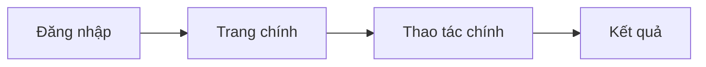

# UI flow

> FE giữ file này. Nó ghi mỗi vai thấy màn hình nào, đi qua những bước nào và gặp những trạng thái nào. Luật nghiệp vụ
> không viết lại ở đây mà link về `docs/domain/`.

## Vai và quyền

| Vai | Thấy gì | Làm được gì |
|---|---|---|
| | | |

## Luồng

<!-- Thay sơ đồ mẫu bằng luồng thật, mỗi vai một luồng. -->

## Màn hình

<!-- Mỗi màn một mục, đánh mã SCR-NNN để spec và task link tới. -->

### SCR-001: <tên màn>

- **Vai:**
- **Mục đích:**
- **Thành phần chính:**
- **Trạng thái:** loading, empty, error, thành công
- **Wireframe:** <!-- link ảnh hoặc file thiết kế, ghi phiên bản -->

## Chưa chốt

<!-- Những chỗ còn chờ trả lời, link tới câu hỏi Q-NNN. -->
